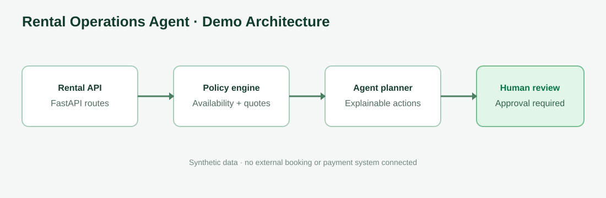

# Rental Operations AI Agent

A runnable rental-business operations demo for beach equipment, vehicles, tools, and vacation-rental teams. It combines booking availability, quote preparation, return-risk triage, maintenance flags, and human-approved actions behind a FastAPI service.



> **Demo scope:** deterministic policies + synthetic data. This is not connected to a live booking platform, payment processor, messaging provider, or production AI model. The “agent” produces explainable recommendations; it does not autonomously charge customers, confirm real bookings, or dispatch staff.

## Features
- Browse rental inventory and availability for a requested period.
- Create a quote with itemized pricing and a transparent total.
- Detect schedule conflicts before creating a booking request.
- Flag overdue returns and equipment maintenance needs.
- Produce an operations recommendation with evidence and a required approval action.
- FastAPI OpenAPI docs, synthetic fixtures, tests, Docker, and GitHub Actions.

## Quick start
Requires Python 3.11+.

```bash
git clone https://github.com/HardikPaghdar/rental-operations-ai-agent.git
cd rental-operations-ai-agent
python -m venv .venv
source .venv/bin/activate  # Windows: .venv\\Scripts\\activate
pip install -e ".[dev]"
uvicorn app.main:app --reload
```

Open http://127.0.0.1:8000/docs.

## Try it

List inventory:
```bash
curl http://127.0.0.1:8000/inventory
```

Check availability:
```bash
curl "http://127.0.0.1:8000/availability?item_id=beach-chair-01&start=2026-11-10&end=2026-11-12&quantity=2"
```

Create a quote:
```bash
curl -X POST http://127.0.0.1:8000/quotes \
  -H "Content-Type: application/json" \
  -d '{"item_id":"beach-chair-01","quantity":2,"days":3}'
```

Request an operational recommendation:
```bash
curl -X POST http://127.0.0.1:8000/agent/recommend \
  -H "Content-Type: application/json" \
  -d '{"scenario":"late_return","booking_id":"BK-204","hours_late":5}'
```

The response includes a recommended action, rationale, and whether a human approval is required.

## API
| Method | Endpoint | Purpose |
|---|---|---|
| GET | `/health` | Health check |
| GET | `/inventory` | Rental catalogue |
| GET | `/availability` | Date-range availability check |
| POST | `/quotes` | Calculate a quote |
| GET | `/bookings` | Synthetic booking list |
| POST | `/agent/recommend` | Explainable operations recommendation |

## Project structure
- `app/main.py` — API routes and business logic
- `tests/` — availability, quote, and policy tests
- `data/` — synthetic inventory and bookings
- `docs/architecture.svg` — architecture preview
- `.github/workflows/ci.yml` — automated tests
- `Dockerfile` — containerized API

## Production integration roadmap
1. Add a real inventory/booking repository and transactional reservation locking.
2. Integrate a rental platform or calendar provider through isolated adapters.
3. Add authentication, tenant isolation, RBAC, audit logs, and PII retention controls.
4. Add payment provider sandbox integration; require approval before capture/refund.
5. Add an LLM planner behind a strict tool allowlist, structured outputs, and policy checks.
6. Add idempotency, retries, observability, alerting, and end-to-end sandbox tests.

## Safety
Availability checks in this demo use static synthetic bookings and are not a guarantee of real inventory. Never use demo data or recommendations to make real customer commitments. All consequential actions must be reviewed by an authorized operator.

## License
MIT
